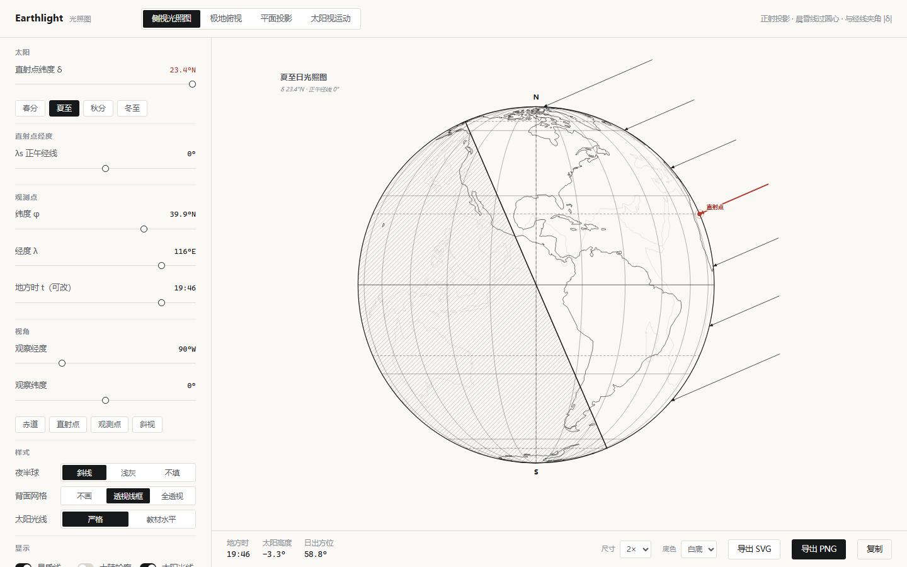
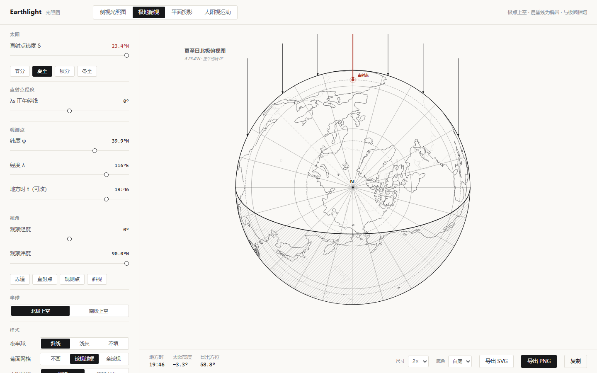
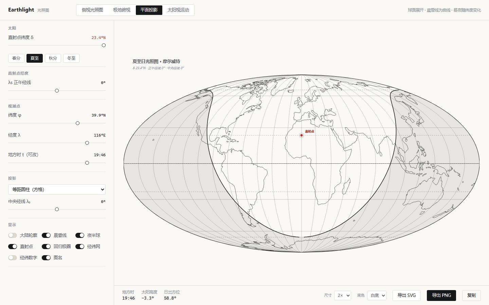
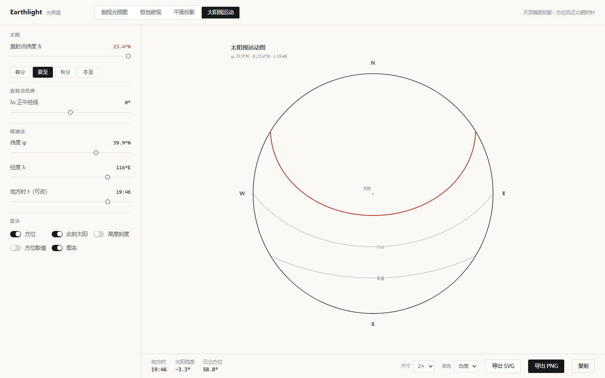

# Earthlight · 地球光照图出图器

Zero-dependency single-file tool for geography teaching: Earth-sun illumination, polar views, world map projections and sun-path charts from subsolar-point and observer parameters. Exports SVG/PNG.

一个零依赖单文件小工具，给地理老师出「地球光照 / 晨昏线 / 太阳视运动 / 世界地图」教学图。
**双击 `index.html` 即用**：不需要联网、不需要安装，SVG 全部现算现画。

## 效果

| 侧视光照图（叠加大陆轮廓） | 极地俯视 |
|---|---|
|  |  |

| 平面投影（摩尔威特） | 太阳视运动 |
|---|---|
|  |  |

---

## 四个出图视角

| 标签 | 出什么图 | 对应试卷题型 |
|---|---|---|
| 侧视光照图 | 地轴竖直的侧视球体，夜半球打斜线 | 侧视光照图、判昼夜长短 |
| 极地俯视 | 北极 / 南极上空俯视，晨昏线为椭圆弧 | 极点俯视图、判自转方向 |
| 平面投影 | 球面展开的世界地图，晨昏线为曲线 | 方格经纬网图、世界地图判读 |
| 太阳视运动 | 天顶等距投影，地平圈标 N/E/S/W | 二分二至太阳视运动轨迹 |

## 参数

- **直射点纬度 δ**（−23.44…23.44）：春分/夏至/秋分/冬至四个按钮 + 滑块微调。只暴露 δ，不让日期反算。
- **直射点经度 λs**：正午所在经线，决定图上哪条经线是 12:00。
- **观测点 φ / λ**：左下「地方时」跟着变（t = 12 + (λ−λs)/15），太阳视运动图按这个点画。
- **视角（观察经度 / 观察纬度）**：赤道侧视、正对直射点、正对观测点，或任意斜视。
- **中央经线 λ₀**（平面投影专用）：让地图以哪条经线居中。

侧视与俯视是**同一套正射投影引擎**：观察纬度设 ±90 就得到极地俯视图，设任意仰角就是斜视图。

## 五种平面投影

等距圆柱（方格）、摩尔威特、罗宾逊、温克尔三重、墨卡托。
平面图上晨昏线不再是直线或椭圆，而是一条随纬度弯曲的曲线；极昼极夜表现为地图上下边缘的整段阴影。

## 大陆轮廓（可选）

勾上「大陆轮廓」即叠加海岸线，方便出"有陆地参照"的题。
数据来自 [Natural Earth](https://www.naturalearthdata.com/) 110m land（**公有领域**），经简化、量化后压缩成约 9 KB 的字符串内嵌在 `index.html` 里，仍然是单文件。

## 出图

右上工具栏：尺寸 1×/2×/3×、底色白底/透明、导出 SVG、导出 PNG、复制（直接粘进 PPT）。
图会自动裁到内容边界，导出的 SVG 可以在 PPT / Word / AI 里当矢量图再编辑。

## 两条约定（画法上的取舍）

1. **严格模式**（默认）：太阳光线按 δ 真实倾斜。此时晨昏线是**过圆心的直线**（正对阳光时）或**椭圆弧**（斜视时），它与经线的夹角恒为 |δ|，与 ±(90°−|δ|) 纬线在圆周处相切。
2. **教材水平模式**：把光线强行画成水平，这是教材示意的唯一「作弊」处；地轴竖直、晨昏线倾 |δ| 两条保持不变。

## 其它

- `#globe` / `#polar` / `#flat` / `#sky` 可直接链接到某个视角。
- 图名一行小字默认写，可在「显示」里关掉。
- 夜半球：45° 斜线（默认）/ 浅灰 12% / 不填；平面图统一用浅灰。
- 背面网格：不画 / 透视线框（40% 淡）/ 全透视。

---

## 开发

交付物是**单文件** `index.html`，但仓库里保留了可维护的源文件与构建步骤：

```
src/projections.js      五种投影（window.PROJ）
src/coast.js            海岸线编码 + decodeCoast()（window.COAST）
data/ne_110m_land.geojson  Natural Earth 原始数据（公有领域）
tools/build-coast.mjs   简化 → 量化 → 变长编码，生成 src/coast.js
scripts/inline.mjs      把上面两个 src 文件注入 index.html 的标记区
scripts/verify-proj.mjs 投影契约的外部验收（独立于 src 里的单元测试）
```

改完 `src/` 里的东西，跑一次：

```bash
node scripts/inline.mjs
node src/projections.test.mjs    # 投影单测
node scripts/verify-proj.mjs     # 外部契约验收
```

`index.html` 里有两段 `<!-- BUILD:xxx:start/end -->` 标记，**只改标记之外的部分**才是手改，标记内会被覆盖。

## License

MIT（代码）· Natural Earth 数据为公有领域
